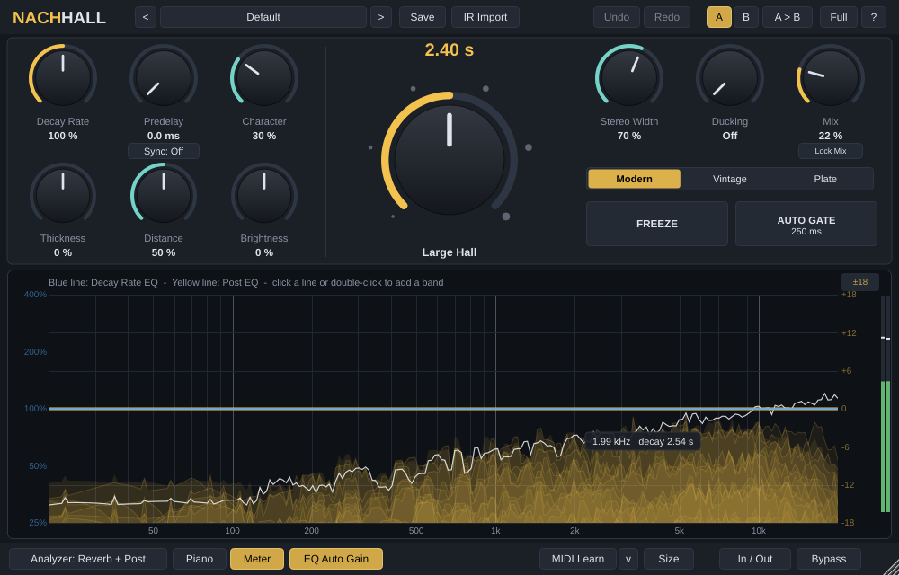

# Nachhall – Hall‑Plugin (VST3)



**Nachhall** ist ein algorithmischer Hall. Bedienung und Funktionen:
Space‑Regler mit Raummodellen, Decay Rate, Decay‑Rate‑EQ, Post‑EQ, Freeze, Ducking, Auto Gate, Modern/Vintage/Plate und IR‑Import.
---

## 1. Fertiges Plugin herunterladen

1. Auf GitHub im Repository oben auf **Actions** klicken.
2. Links **„Build Nachhall“** wählen → den neuesten Lauf mit grünem Haken öffnen.
3. Unten bei **Artifacts** **`Nachhall-Windows-VST3`** herunterladen.
4. Entpacken. Die Datei `INSTALL.txt` erklärt jeden Schritt.

Gebaut wird automatisch nur für Windows. Auf dem Mac lässt sich Nachhall selbst bauen (Abschnitt 6, auch als AU).

(Artifacts sind 90 Tage verfügbar. Danach einfach einen neuen Lauf über **Run workflow** starten.)

## 2. Installieren

**Windows**
- Ganzen Ordner `Nachhall.vst3` nach `C:\Program Files\Common Files\VST3\` kopieren.

**Dann in MASCHINE**
- MASCHINE starten. Falls Nachhall fehlt: *Preferences → Plug-ins → Manager → Rescan*.
- Sound, Group oder Master wählen → freien Plug‑in‑Slot → **DusHfm Audio → Nachhall**.
- Als Send‑Effekt (Aux): **Mix auf 100 %**.
- Hinweis: Sehr alte MASCHINE‑Versionen laden nur VST3s von NI. Dann MASCHINE updaten.

## 3. Hardware‑Regler an MASCHINE

Die Parameter liegen so, dass die 8 Drehregler sofort Sinn ergeben:

| Seite | Regler 1–8 |
|---|---|
| 1 | Space · Decay Rate · Mix · Predelay · Character · Distance · Brightness · Stereo Width |
| 2 | Thickness · Style · Ducking · Freeze · Auto Gate · Gate Hold · Predelay Sync · Predelay Offset |
| 3 | Input Level · Input Pan · Output Level · Output Pan · Gate Sync · EQ Auto Gain · Bypass |
| 4+ | Bänder vom Decay‑Rate‑EQ und Post‑EQ |

Für das kleine Hardware‑Display gibt es Kurznamen (max. 8 Zeichen), z. B. „Decay“, „Width“, „D1 Freq“, „P3 Gain“.

## 4. Funktionen (wie Pro‑R 2)

| Funktion | Was sie macht |
|---|---|
| **Space** | Stufenloser Regler: 11 Raummodelle von *Ambience* über *Hall* bis *Cathedral* und *Abyss*, 0,2 s bis 10 s. 6 Raum‑Symbole um den Regler = Schnellwahl (0,20 / 0,75 / 1,85 / 3,20 / 5,20 / 10,0 s wie bei Pro‑R 2). Die gelbe Zeit ist die angezeigte Hallzeit; gemessen klingt der Hall wie bei Pro‑R 4–16 % länger. |
| **Decay Rate** | Hallzeit 25 % bis 400 % des Raums. Die gelbe Zeit zeigt die echte Hallzeit. |
| **Style** | **Modern** (natürliche Räume), **Vintage** (klassischer Digitalhall: kleine Räume klingen kürzer, große dunkler), **Plate** (schneller, dichter Anstieg, metallisch). Beide an Pro‑R‑Aufnahmen angepasst. |
| **Predelay** | 0–500 ms. **Sync** auf 1/4, 1/8, 1/16, 1/32 → Regler wird zu **Predelay Offset** (50–200 %, z. B. 150 % = punktiert). |
| **Character** | 0–100 % (Start 30 %). 0 % sauber, 50 % lebendig (leichte Modulation, Erstreflexionen 2 dB lauter), 100 % chorusartig. |
| **Thickness** | −100 … +100 % (Start 0 %). Plus = dichter, laute Signale werden verdichtet (wie ein Kompressor 2:1), ab 0 % leichte Sättigung. Minus = luftiger, leise Signale werden leiser (Expander). |
| **Distance** | 0–100 % (Start 50 %). Nah = starke, helle Erstreflexionen. Weit = langsamer Aufbau, diffuser Hall. |
| **Brightness** | −100 … +100 % (Start 0 %). Minus = dunkler, kürzere Höhen, mehr Bass. Plus = heller, längere Höhen. |
| **Stereo Width** | 0–120 % (Start 70 %). 0 % mono · 50 % starkes Übersprechen · 100 % getrennte Kanäle · bis 120 % extra breit. |
| **Ducking** | Hall wird leiser, solange das Signal spielt (Bereich in dB). |
| **Auto Gate** | Schneidet den Hall nach dem Signal ab. Klick = an/aus, ziehen = Haltezeit, Rechtsklick = Tempo‑Sync. |
| **Freeze** | Endloser Hall. Klick = an/aus, gedrückt halten = nur solange gedrückt. Der eingefrorene Hall bleibt gleich laut und gleich hell. Character und Brightness wirken weiter, Distance und Thickness nicht (wie bei Pro‑R). |
| **Mix + Lock Mix** | Trocken/Nass (Start 22,5 %). *Lock Mix* behält den Mix beim Preset‑Wechsel (gilt auch für neue Instanzen). |
| **Decay‑Rate‑EQ** (blau) | 6 Bänder: Glocke, Low Shelf, High Shelf, Notch. Stellt ein, wie lange jede Frequenz nachklingt. |
| **Post‑EQ** (gelb) | 6 Bänder: Glocke, Shelves, Low/High Cut bis 96 dB/Okt. Pro Band Stereo, Links, Rechts, Mid oder Side. Automatische Lautstärke‑Korrektur. |
| **Analyzer** | Spektrum + Abkling‑Darstellung pro Frequenz. Modi: Reverb+Post, Pre+Post, Aus. Optional Klaviatur und Pegelanzeige. |
| **IR‑Import** | WAV/AIFF‑Impulsantwort laden (oder ins Fenster ziehen). Wird analysiert und in Space, Decay‑Rate‑EQ und Post‑EQ umgerechnet. |
| **Presets** | 43 Werks‑Presets. Browser (Klick auf den Preset‑Namen) mit Suche, Ordnern, Favoriten (Stern), Tags, Autor und Beschreibung. „Save As Default“ = eigenes Start‑Preset. Der Name wird abgedunkelt (*), sobald du etwas änderst. A/B‑Vergleich, Undo/Redo. |
| **MIDI Learn** | Taste „MIDI Learn“ unten → Regler anklicken → Knopf am MIDI‑Controller bewegen. Menü „v“: MIDI an/aus, Zuordnungen löschen, Revert, Save. |
| **Größe** | „Size“: Medium, Large, Extra Large (gilt auch für neue Instanzen), „Full“ = Vollbild (Esc beendet), Ecke ziehen = frei. |
| **In/Out** | Eingangs‑ und Ausgangspegel mit Panorama, weicher Bypass ohne Knacksen. |
| **Fenster** | Stufenlos skalierbar (Ecke unten rechts ziehen). |

## 5. Bedienung

**Regler** (wie bei FabFilter)
- Ziehen hoch/runter – reagiert auf das Tempo der Maus. **Shift** = fein (auch beim Mausrad).
- **Strg/Cmd + Klick** = Standardwert. **Doppelklick** = Wert eintippen: z. B. „250 ms“, „1k“, „A4“, „2x“ (= +6 dB), „50%“ (= Mitte), beim Space‑Regler auch „Cathedral“ oder „2.5 s“.

**Display**

- **Blaue Linie** anklicken und ziehen → neues Decay‑Rate‑Band. **Gelbe Linie** → neues Post‑EQ‑Band.
- **Doppelklick** auf freie Fläche → Post‑EQ‑Band (am Rand: Low/High Cut). Ganz unten → Decay‑Notch.
- **Punkt ziehen** = Frequenz + Wert. **Shift** = fein, **Alt** = nur eine Richtung, **Strg/Cmd + ziehen** = Güte (Q).
- **Mausrad** auf einem Punkt = Güte (Q).
- **Alt + Klick** = Band aus/an. **Strg/Cmd + Alt + Klick** = Form wechseln.
- **Rechtsklick** = Menü (Form, Stereo‑Platz, Flankensteilheit, Löschen). **Doppelklick auf Punkt** = Werte eintippen (auch „2k“ oder „A4“).
- **Entf** = markierte Bänder löschen. Ziehen auf leerer Fläche = mehrere Bänder markieren, **Shift + Klick** = Bereich, **Strg/Cmd + Klick** auf Punkt = hinzufügen. Mehrere Bänder ziehen = Werte skalieren gemeinsam.
- **Alt + Shift + Klick** auf Low/High Cut = nächste Flankensteilheit. **Strg/Cmd + Klick** auf freie Fläche = neues Band.
- Beim gewählten Band erscheint ein Panel direkt am Punkt (An/Aus, Form, Stereo‑Platz, Werte, Löschen).
- **Klaviatur** („Piano“): Punkt anklicken = rastet auf die nächste Note ein, ziehen = in Halbtonschritten.
- **Strg/Cmd + Z** = Rückgängig, **Strg/Cmd + Shift + Z** = Wiederholen.

## 6. Selbst bauen (optional)

Voraussetzung: CMake ≥ 3.22 und Visual Studio 2022 (Windows) bzw. Xcode‑Tools (Mac). JUCE wird automatisch geladen.

```bash
cmake -S . -B build -DCMAKE_BUILD_TYPE=Release
```

```bash
cmake --build build --config Release --target Nachhall_VST3
```

Das Plugin liegt danach in `build/Nachhall_artefacts/Release/VST3/`.

## 7. Tests

- `NachhallDspTests`: misst Hallzeiten (Abweichung meist unter 3 %), Decay‑EQ, Stabilität bei Zufalls‑Automation,
  Freeze, Ducking, Gate, Pegel aller Räume und Styles gegen Pro‑R (erreicht ±0,1 dB) und CPU‑Last.
- `NachhallBehaviourTests`: prüft jede Aussage der Pro‑R‑2‑Hilfe zu den Reglern per Messung (15 Bereiche,
  32 Einzelmessungen). Wo Pro‑R gemessen wurde, vergleicht der Test mit den gemessenen Pro‑R‑Werten
  (Ergebnisse in [docs/VERGLEICH-PRO-R.md](docs/VERGLEICH-PRO-R.md)).
- `NachhallReference`: Messpaket für den Vergleich mit Aufnahmen des echten Pro‑R 2 (Testsignale, Messplan,
  Auswertung, Anpassung). Anleitung: [reference/ANLEITUNG.md](reference/ANLEITUNG.md).
  `NachhallReference match reference/pro-r-messwerte.csv` vergleicht Nachhall mit den Messwerten der 52
  Pro‑R‑Aufnahmen (läuft bei jedem Build in GitHub Actions). Die Aufnahmen selbst sind nicht öffentlich,
  im Repository liegen nur die daraus gemessenen Werte.
- GitHub Actions baut Windows, führt die Tests aus und prüft das VST3 mit **pluginval** (höchste Stufe).
- Entwickler‑Werkzeuge (optional): `-DNACHHALL_BUILD_HOSTTEST=ON` lädt das fertige VST3 wie eine DAW,
  `-DNACHHALL_BUILD_UISHOT=ON` rendert die Oberfläche als Bild (`NachhallUiShot --midi` prüft MIDI Learn).

## 8. Alte Projekte und Presets

Seit Version 2 der Einstellungen nutzt Nachhall die Skalen von Pro‑R 2 (Brightness/Thickness −100 … +100 %,
Width bis 120 %, 11 Raummodelle). Projekte und Presets aus älteren Nachhall‑Versionen werden beim Laden
automatisch umgerechnet: Space behält seine Hallzeit, Brightness und Thickness ihre Stellung, Width über 120 %
wird auf 120 % begrenzt. Der Klang ändert sich trotzdem etwas, weil die Raummodelle jetzt an Pro‑R angepasst sind.

## 9. Grenzen

- Kein Surround/Dolby Atmos (MASCHINE arbeitet in Stereo).
- Formate: VST3 und Standalone (selbst gebaut auf dem Mac auch AU). Kein VST2, CLAP oder AAX.
- In MASCHINE brauchst du MIDI Learn meist nicht: MASCHINE weist die Hardware‑Regler selbst zu.
- Keine Latenz (0 Samples).

## Lizenz‑Hinweis

Nachhall nutzt das JUCE‑Framework (AGPLv3 oder kommerzielle Lizenz). Für den privaten Einsatz ist das kein Problem.
Wer das Plugin weitergibt oder verkauft, muss die JUCE‑Lizenzbedingungen beachten.
„FabFilter“ und „Pro‑R“ sind Marken der FabFilter B.V.; Nachhall ist ein eigenständiges Projekt ohne Verbindung zu FabFilter.
